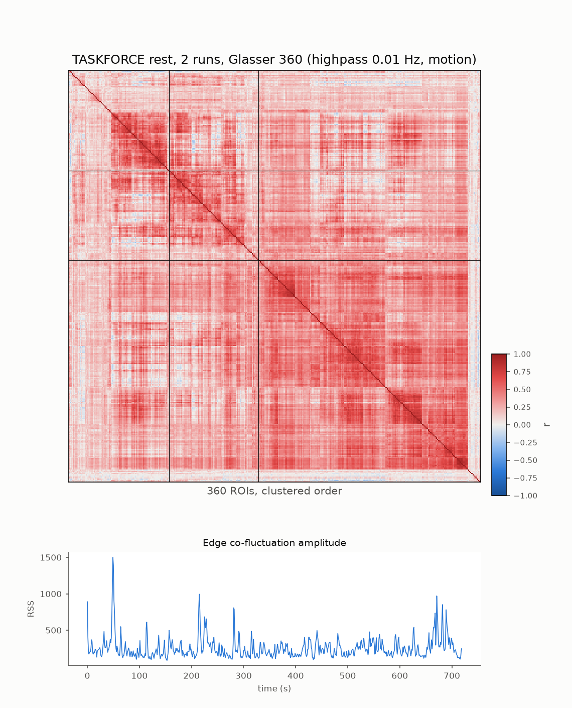
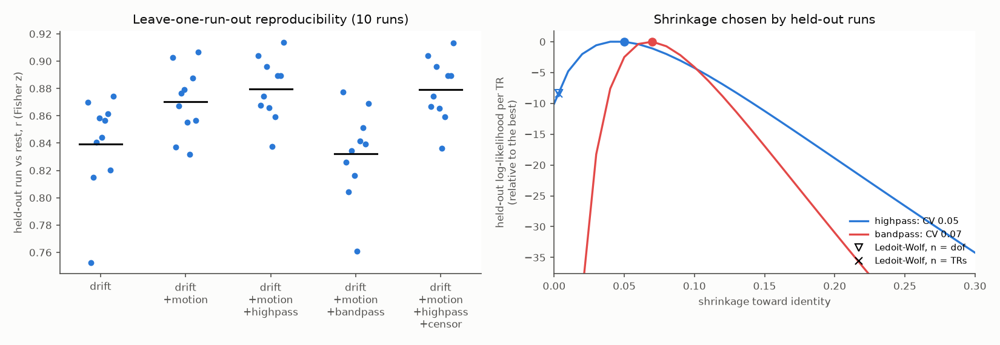
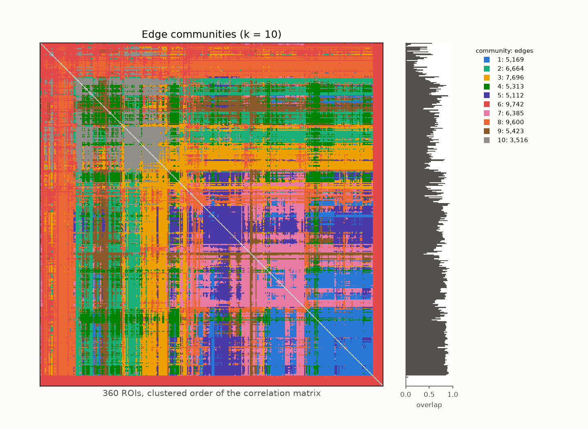

# Functional connectivity: `ffs_fc`

`ffs_fc` computes functional connectivity between ROIs, seeds and voxels, with the
nuisance cleaning done in the same call. It does the job of AFNI's `3dTproject` and
`3dNetCorr` (and `3dTcorr1D` for seed maps) in one step, on the CPU or the GPU, and it
adds partial and shrunk correlations, task-weighted correlations, edge time series,
and cross-validation across runs.

This page covers:

1. **What it computes**, and the maths behind each output.
2. **Why it is built this way**: the design choices, and what each one protects against.
3. **Validity**: agreement with `3dNetCorr`, `3dTproject`, `3dTcorr1D` and nilearn
   on the same data, plus checks of the internal identities.
4. **Run-to-run reproducibility**: networks found in one session reappear in the
   others, and leave-one-run-out cross-validation costs one pass.
5. **Speed.**
6. **Limits.**

Every number on this page is in `docs/fc/numbers.json`.
`scripts/fc_validation/validate.py` regenerates all of them, stage by stage.

## At a glance

| claim | evidence | section |
|---|---|---|
| Same matrices as `3dNetCorr` | max diff 1e-4 (its 4-decimal output), maps 7e-5, 345 ROIs | 3 |
| Same cleaning as `3dTproject` | ≤ 7e-4 max, ~3e-5 median, same dof, with bandpass / motion / censoring | 3 |
| Same as `3dTcorr1D` and nilearn | 1.4e-6 and 1.9e-5 | 3 |
| FFT cleaning = regression | same dof, 4e-5 relative difference on 310k voxels × 3600 TRs | 3 |
| Edge communities match the reference MATLAB code | same best inertia, ARI 0.97–0.99 vs MATLAB's best (its own reruns: 0.65–0.87); node measures to 1e-16; 5–8× faster | 3 |
| Networks reproduce across runs | each 6-min run vs the other nine: r = 0.83–0.88 under every cleaning | 4 |
| Shrinkage by held-out runs beats Ledoit–Wolf | CV picks ~0.05, LW ~0.003; CV wins the held-out likelihood | 4 |
| Leave-one-run-out costs one pass | 31 s for 10 runs and 10 folds, vs 323 s as per-fold calls and ~70 min as per-fold AFNI | 5 |
| Faster than the reference chains | 9–23× vs `3dTproject`/`3dNetCorr`, 8× vs nilearn, on the CPU; reading the input is most of what is left | 5 |


## 1. What it computes

```
ffs_fc -input run1.nii.gz run2.nii.gz ... -atlas atlas.nii.gz -mask brain.nii.gz \
       -ortvec_run motion_r1.1D motion 1 -ortvec_run motion_r2.1D motion 2 \
       -censor censor.1D -passband 0.01 0 \
       -part_corr -shrink cv -loro -edge -wb_z -plot -prefix sub01
```

### ROI time courses

Each ROI's time course is the mean of its voxels. The ROIs come from `-atlas`/`-rois`,
the same resolver every ffs tool uses: a 3-D integer label map (any number of parcels),
a binary mask, a 4-D weight stack (overlapping or probabilistic ROIs), or surface
labels (`.label.gii`, `.annot`) for surface data. `-seed_1D` adds external time
courses (physiology, a task regressor, an ROI from another dataset) as extra rows.

By default each voxel is first scaled to percent signal change within each run:
`y = 100 x / mean(x)`, clipped at 200. Without this, a voxel's weight in its ROI mean
is its brightness. At high field, voxels near the coil and large veins are the
brightest, so they would pull every ROI mean toward their own signal. `-no_scale`
averages raw intensities, which is what `3dNetCorr` does. Voxels that are constant in
any run (out of the field of view, dead slices) are left out of every mean. Scaling is
refused for data with no positive baseline (residuals, z-scored series), because a
percentage of zero is meaningless.

### Cleaning: one projection per run

For run `r`, with kept (uncensored) time points `K_r`, the nuisance matrix is

```
N_r = [ Legendre polynomials of degree 0..p  |  -ortvec* columns  |  stopband sines/cosines ]
```

and the cleaned series is the residual of projecting `N_r` out on the kept rows only:

```
y_r  <-  y_r[K_r] - Q_r Q_r^T y_r[K_r],      Q_r = orthonormal basis of N_r[K_r]
```

Three choices are built into this.

- **Censored TRs leave before the fit.** A spike left in the rows pulls the drift
  and motion fits, and dropping it afterwards leaves that distortion in every other
  TR. This is `3dTproject -cenmode KILL`.
- **Per run, block-diagonal.** Each run gets its own polynomials and its own
  regressors (`-ortvec_run`, `-ortvec_glob`, or full-length files split at run
  boundaries). Concatenated runs differ in mean and drift, and a step shared by every
  ROI at a run boundary is a correlation shared by every ROI.
- **A passband is a set of regressors, removed in the same projection.** Every
  Fourier frequency of the run outside the passband contributes a sine and a cosine.
  Removing them together with the motion regressors means the band is removed *given*
  the regressors. Filtering in one step and regressing in another leaves the data
  correlated with the regressors again (Lindquist et al., 2019). The frequencies follow
  `3dTproject`'s rule exactly, edge rounding included (section 3).

`Q_r` comes from an SVD of the unit-norm columns of `N_r`, keeping singular values
above `1e-6` of the largest. Collinear columns are rank deficiency, not regressors:
a stopband sine the polynomials already span, a motion column that censoring has
flattened, an xmat's drift plus a requested `-polort`. QR would return those as
directions of noise, and projecting them out removes real signal.

**Two exact algorithms, picked per run.** A run with no censored TR and a passband is
cleaned in the frequency domain: zero the stopband rfft bins, then project out the
*band-filtered* nuisance. On a whole run the DFT basis is orthogonal, so zeroing bins
is the stopband projection, and

```
span(stopband, N)  =  span(stopband)  ⊕  span(P_band N)
```

That gives the same residual and the same dof at O(T log T) per series, where the
regression needs O(T·k) with k ≈ 600 columns for a 0.01–0.1 Hz band at TR 1 s.
Censored runs use the regression. A test pins the two together, and section 3 checks
it on real data.

**Degrees of freedom.** Every output carries the residual dof:

```
dof = (kept TRs) - (total rank of the N_r)
```

A bandpass is expensive. 0.01–0.1 Hz at TR 1 s removes about 81% of the dimensions
(295 regressors per 360-TR run), and each r then rests on the residual dof, not on
the number of TRs. `ffs_fc` prints that cost. A highpass alone (`-passband 0.01 0`)
removes 12 dimensions per run.

### Correlation

With every cleaned series centred and scaled to unit length (`x̂ = (x - x̄)/‖x - x̄‖`),
a correlation is a dot product and a matrix is one GEMM:

```
R = X̂ X̂^T                       (CC)
Z = atanh(R),  |Z| <= 4          (FZ; the cap is AFNI's, r = 0.999329)
```

**Weighted correlation** (`-weight_corr`, one matrix per weight column). With per-TR
weights `w >= 0`, centre on the weighted mean and scale by `sqrt(w)`:

```
x̃ = (x - Σ w x / Σ w) · sqrt(w),    R_w = normalise(X̃ X̃^T)
```

0/1 weights give the correlation over the selected TRs. A condition's block or
HRF-convolved regressor as the weight gives a task-weighted connectivity. This is
`3dNetCorr -weight_corr`, generalised to several weightings in one pass.

### Partial correlation and shrinkage

```
M = R^{-1}:     PC_ij  = -M_ij / sqrt(M_ii M_jj)      (partial correlation)
                PCB_ij = -M_ij / M_ii                  (partial regression, row on column)
```

`R` can only be inverted with fewer ROIs than residual dof. That is a fact about rank,
not about numerics: after cleaning, every series lives in the same dof-dimensional
subspace, so N > dof series are linearly dependent and `R` has rank at most dof - 1.
FFT filtering hits the same limit, because it is the same projection; it only hides it.
`ffs_fc` refuses the plain partial correlation in that case and says why. `3dNetCorr`
writes an all-zero PC block for the same input (section 3).

Shrinking toward the identity, `R(a) = (1 - a) R + a I`, makes `R` invertible for any
`a > 0`. Two ways to choose `a`:

- **`-shrink lw`, Ledoit–Wolf.** The analytic intensity, computed on the standardised
  series. Its sampling-noise term assumes n independent samples. By default
  (`-lw_samples dof`) n is the residual dof, because after a passband the time points
  are far from independent. `-lw_samples tr` uses n = TRs, the textbook formula
  scikit-learn and nilearn compute.
- **`-shrink cv`, cross-validated.** The intensity that maximises the held-out
  Gaussian log-likelihood of each left-out run under the shrunk correlation of the
  others:

  ```
  ℓ_k(a) = -½ [ log det R_{-k}(a) + tr( R_{-k}(a)^{-1} R_k ) ]
  ```

  One eigendecomposition `R_{-k} = V Λ V^T` per fold gives the whole grid, since
  `R_{-k}(a)` has eigenvalues `(1 - a) λ + a` and
  `tr(R(a)^{-1} R_k) = Σ_i (V^T R_k V)_ii / ((1 - a) λ_i + a)`.
  Both Ledoit–Wolf variants are scored on the same folds and recorded in
  `PREFIX.json`.

### Cross-validation across runs

Each run is cleaned on its own, so its whole contribution to any correlation is three
sufficient statistics (weighted, in general):

```
S_r = X_r W_r X_r^T,     s_r = X_r w_r,     n_r = Σ w_r
C(A) = Σ_{r∈A} S_r  -  (Σ s_r)(Σ s_r)^T / Σ n_r,      R(A) = normalise(C(A))
```

The matrix over any subset of runs is exact from these sums. So every per-run matrix
(`-per_run`) and every leave-one-run-out fold (`-loro`, `-shrink cv`) comes from the
single cleaning pass, each fold an O(N²) subtraction. This is the GLM's rule that
nuisance must be fold-local, satisfied for free because the nuisance was run-local
all along. `-loro` reports, for each run, the correlation between its own matrix and
the matrix of all the other runs (Fisher z, upper triangle).

### Whole-brain maps

`-wb_corr` / `-wb_z` correlate every voxel's cleaned time course with every ROI and
seed. The output is a 4-D NIfTI with one sub-brick per ROI, labelled by name. The r
maps carry AFNI's `fico` statistic parameters (kept TRs, 1, removed dimensions), so
AFNI thresholds them with the correct dof. Voxels stream through the device in
memory-planned chunks.

### Edge time series

For population z-scored ROI series `z_i`, the edge time series is
`e_ij(t) = z_i(t) z_j(t)` (Faskowitz et al., 2020; Esfahlani et al., 2020). Its time
average is exactly `r_ij`: population z-scores make that an identity, where MATLAB's
`zscore` (T - 1) would scale every edge by (T - 1)/T. The co-fluctuation amplitude

```
RSS(t) = sqrt( Σ_{i<j} e_ij(t)² ) = sqrt( ((Σ_i z_i²)² - Σ_i z_i⁴) / 2 )
```

needs no edge matrix, so `-edge` costs O(N·T) for any number of ROIs. `-edge_ts`
writes all N(N - 1)/2 edge series (float32, streamed through a memory map).

### Edge communities and edge functional connectivity

`-efc K` groups the E = N(N - 1)/2 edges into K communities by k-means
(Faskowitz et al., 2020). It clusters the edge series themselves, each edge a point
in T dimensions with squared Euclidean distance, as the authors' reference code does
(`kmeans(ets', k, 'distance', 'sqeuclidean')`). It uses k-means++ seeding, 10
restarts, and keeps the lowest inertia. Each ROI's N - 1 edges then spread over the
communities, which gives two node measures:

```
overlap_i  = -Σ_c p_ic log p_ic / log K      p_ic = fraction of i's edges in community c
sim_ij     = fraction of positions where rows i and j of the community map agree
```

Overlap is 0 when all of an ROI's edges share one community and 1 when they spread
evenly. These are the reference's `fcn_node_entropy` and `fcn_profilesim`.

**eFC** is the cosine similarity of every pair of edge series, `eFC = Ê Êᵀ` with each
row of Ê (E×T) scaled to unit length. It is E×E: 4.2 × 10⁹ entries (17 GB) for 360
ROIs. Clustering eFC's rows instead of the series (`-efc_on efc`) needs only the
distances between rows, and

```
‖eFC_k − eFC_l‖² = (ê_k − ê_l)ᵀ G (ê_k − ê_l),     G = ÊᵀÊ  (T×T) = V Λ Vᵀ
```

so the rows of `Ê V Λ^½` (E × rank, rank ≤ T) have exactly those distances, and
k-means on them *is* k-means on eFC. The correlation distance (`-efc_on efc_corr`,
MATLAB's `'correlation'`) is the same with `G − s sᵀ/E`, `s = Σ ê_k`, and the embedded
rows normalised. At 360 ROIs and 720 TRs the embedding is 0.19 GB. `-efc_full` writes
the whole matrix when the disk has room.

### Outputs

| file | contents |
|---|---|
| `PREFIX.netcc` | matrices in `3dNetCorr`'s layout (4 decimals; FATCAT tools read it) |
| `PREFIX_fc.npz` | the same matrices at full precision, ids, names (and `CC_runs` with `-per_run`) |
| `PREFIX_rois.tsv` | one row per ROI: id, name, voxels (and graph metrics with `-graph`) |
| `PREFIX.json` | kept TRs, dimensions removed, residual dof, shrinkage, LORO summary, settings, atlas path |
| `PREFIX_ts.tsv` | cleaned ROI time series (`-ts_out`) |
| `PREFIX_wb_r` / `_wb_z` | whole-brain maps, one sub-brick per ROI or seed |
| `PREFIX_rss.tsv`, `PREFIX_edge_ts.npy`, `PREFIX_edges.tsv` | edge outputs |
| `PREFIX_efc_edges.tsv`, `_efc_nodes.tsv`, `_efc.npz` | community per edge; overlap and community fractions per ROI; the ROI × ROI community map and profile similarity (`-efc`) |
| `PREFIX_efc.npy`, `PREFIX_efc.png` | the full E × E eFC (`-efc_full`); the community map and overlap (`-efc -plot`) |
| `PREFIX_loro.tsv` | reproducibility of each held-out run |
| `PREFIX_shrink_cv.tsv` | held-out log-likelihood per shrinkage value, mean and per run (`-shrink cv`) |
| `PREFIX_fc.png` | the matrix in clustered order with module lines, and the RSS trace (`-plot`) |



*`ffs_fc -plot` on two TASKFORCE rest runs, Glasser 360, highpass and motion regression.
ROIs are in clustered order, with lines at the major modules, and the RSS trace is below.
The matrix is mostly positive because global signal was not removed (section 6).*

The viewer's matrix window, InstaCorr and carpet call the same code
(`fastfuncstuff/connectivity/`). A test pins the viewer's ROI matrix to `ffs_fc`'s on
the same run and atlas.

## 3. Validity

Each check runs `ffs_fc` and the reference tool on the same input with the same
settings, then compares the outputs at full precision.

| check | data | reference | max \|diff\| | median \|diff\| |
|---|---|---|---|---|
| CC / FZ matrix | ds005165 rest, 345 ROIs, 1 run | `3dNetCorr` | 1.0e-4 (the .netcc file's 4 decimals) | — |
| whole-brain r maps, all 345 ROIs | same | `3dNetCorr -ts_wb_corr` | 6.9e-5 | — |
| cleaning: polort 2 | TASKFORCE rest, 2 runs, Glasser 360 | `3dTproject` → `3dNetCorr` | 5.9e-5 | 2.5e-5 |
| + motion (per run) | same | same | 1.4e-4 | 2.5e-5 |
| + bandpass 0.01–0.1 Hz | same | same | 6.8e-4 | 3.4e-5 |
| + highpass + censoring | same | same | 1.5e-4 | 2.5e-5 |
| seed maps (`-seed_1D`, 3 seeds) | TASKFORCE, 1 run | `3dTcorr1D` | 1.4e-6 | — |
| matrix, same cleaning | TASKFORCE, 2 runs, 360 ROIs | nilearn 0.14 `NiftiLabelsMasker` + `ConnectivityMeasure` | 1.9e-5 | 1.5e-6 |
| node overlap (entropy), profile similarity | Faskowitz example, 200 ROIs, 1200 TRs, same labels | `fcn_node_entropy.m`, `fcn_profilesim.m` | 3e-16, 1e-16 | — |

**Edge communities against the MATLAB reference.** k-means starts from random points,
so two runs never give identical labels, even in MATLAB. The comparison is how closely
partitions agree (adjusted Rand index, ARI) and the k-means objective (inertia), on the
reference's own example data with k = 10:

| run | inertia | ARI vs MATLAB best of 10 |
|---|---|---|
| MATLAB, best of 10 restarts | 21,830,723 | 1 |
| MATLAB, single runs (the demo's call), 5 seeds | 21,830,865 – 21,854,516 | 0.65 – 0.87 |
| `ffs_fc`, best of 10, CPU | 21,830,700 | 0.99 |
| `ffs_fc`, best of 10, GPU | 21,830,812 | 0.97 |

`ffs_fc` reaches the reference's best objective, and its partition is closer to
MATLAB's best than MATLAB's own single runs are. Inertia is given on MATLAB's scale:
its `zscore` divides by T - 1, which scales every point by the same factor and leaves
the partition unchanged. A test pins the eFC-row embedding's distances to an
explicitly formed eFC, for both distances.

The residual dof agree with `3dTproject` in every variant (714, 702, 112, 644). Where
`ffs_fc` refuses a partial correlation because ROIs ≥ dof, `3dNetCorr` writes an
all-zero PC block.

**The passband edge rule.** Before the rule was copied, the bandpass matrices differed
from `3dTproject` by up to 0.057. `3dTproject` turns `-passband fbot ftop` into
stopbands `[0, fbot − 1e-4]` and `[ftop + 1e-4, ∞)`, and maps each edge to a Fourier bin
with `rint((edge ∓ df/6)/df)`. So a frequency within about df/3 inside either edge is
removed. At 360 TRs of 1 s that includes 0.1 Hz itself: 295 regressors per run where an
exact-edge rule gives 293. `ffs_fc` now uses the same rule. One quirk comes along with
it: in AFNI, an upper edge above Nyquist (`0.01 99`) still rounds onto the Nyquist bin,
so AFNI's "no lowpass" removes the Nyquist cosine. `ffs_fc -passband 0.01 0` means no
lowpass and keeps it. The parity run passes AFNI's form to both tools.

**Internal identities**, checked on real data as well as in the test suite:

- **FFT path = regression.** 310,004 voxels × 10 runs (3600 TRs), highpass plus motion,
  both algorithms on the GPU: same dof (620), relative residual difference 3.8e-5.
- **Mean edge = r.** The time average of every edge series matches the CC matrix to
  1.6e-7 (64,620 edges × 720 TRs, 0.19 GB as float32).
- **Viewer = CLI.** A test pins the viewer's ROI matrix to `ffs_fc`'s on the same run
  and atlas. A second test pins the cleaner's FFT path to the regression.
- **Ledoit–Wolf = scikit-learn** at `-lw_samples tr` (test).
- **TF32 stays off.** A GPU-marked test runs the cleaner with TF32 switched on
  globally and checks the result is still exact.

## 4. Run-to-run reproducibility

This is not the validation; section 3 is. The point here is narrower: networks that
`ffs_fc` finds in one run come back in the other runs of the same session.

Data: TASKFORCE sub-01, 10 resting runs of 360 TRs (TR 1 s, 1.6 mm, anatomical space),
Glasser's 360 cortical parcels from FreeSurfer, five cleanings. Every run gets its own
polynomials, its own six motion regressors and its own censor list (FD > 0.3 mm; at
most 0.6% of TRs in any run). For each run, the matrix of that run alone is
correlated with the matrix of the other nine (Fisher z, upper triangle).

| cleaning | residual dof | LORO r, mean (min–max) | CV shrinkage | Ledoit–Wolf shrinkage |
|---|---|---|---|---|
| drift (polort 2) | 3560 | 0.84 (0.75–0.87) | 0.06 | 0.003 |
| + motion | 3500 | 0.87 (0.83–0.91) | 0.05 | 0.003 |
| + highpass 0.01 Hz | 3440 | 0.88 (0.84–0.91) | 0.05 | 0.003 |
| + bandpass 0.01–0.1 Hz | 550 | 0.83 (0.76–0.88) | 0.07 | 0.015 |
| + highpass + censoring | 3435 | 0.88 (0.84–0.91) | 0.05 | 0.003 |



*Left: each dot is one run's matrix against the other nine. Right: held-out
log-likelihood against shrinkage for two cleanings; filled dots are the CV choice, open
markers the Ledoit–Wolf choices. The bandpass Ledoit–Wolf point (0.015) is below the
plotted range.*

What this shows:

- **The structure repeats.** A single 6-minute run predicts the other nine with r ≈ 0.85
  under every cleaning.
- **Motion regression helps; a bandpass does not.** The bandpass removes 84% of the
  dimensions and makes each run's matrix slightly *less* like the others.
- **It is not a ranking of pipelines.** Structure that repeats for non-neural
  reasons (global signal, a cardiac-locked vessel, coil sensitivity tied to head
  position) is reproducible too. A cleaning step that removes a real but repeatable
  artefact can lower this number.

**Shrinkage: held-out likelihood against Ledoit–Wolf.** The analytic Ledoit–Wolf
intensity is about 0.003 with either sample count. The intensity the held-out runs
prefer is 15–20 times larger, and its held-out log-likelihood per sample is far higher
(29.9 against 19.6 for drift + motion). Ledoit–Wolf minimises error against the
covariance of the sample in hand. A held-out run differs from it by real run-to-run
variation as well as sampling noise, and Ledoit–Wolf cannot see that variation. With
two or more runs, use `-shrink cv`. Ledoit–Wolf is the fallback for a single run.

**Cross-validation at the cost of one pass.** Because each run's contribution is three
sufficient statistics (section 1), every fold and every shrinkage value comes from the
single cleaning pass. Each row of the table took about 30 s from compressed NIfTI:
loading and cleaning 10 runs, ten folds, and the 101-point shrinkage grid scored on
every fold. Section 5 times this against re-running the cleaning for each fold.

## 5. Speed

All times are wall clock, from compressed NIfTI to files on disk, on the same machine
(Intel Xeon W-2133, 6 cores; NVIDIA RTX 5070 Ti). The `ffs_fc` times include the Python start-up and the read.

**Against the reference tools**

| task | data | reference | reference time | `ffs_fc` |
|---|---|---|---|---|
| matrix + 345 whole-brain maps | ds005165, 1 run, 212 TRs | `3dNetCorr -ts_wb_corr` | 79 s | 3.4 s CPU, 4.1 s GPU |
| clean + matrix, polort 2 + motion | TASKFORCE, 2 runs, 360 ROIs | `3dTproject` → `3dNetCorr` | 80 s | 8.5 s |
| clean + matrix, + bandpass | same | same | 105 s | 8.7 s |
| clean + matrix, + highpass + censor | same | same | 77 s | 8.9 s |
| 3 seed maps | TASKFORCE, 1 run | `3dTcorr1D` | 11.2 s | 8.1 s |
| clean + matrix | TASKFORCE, 2 runs, 360 ROIs | nilearn 0.14 | 66.5 s | 8.7 s |

**Edge communities**

| task | reference | `ffs_fc` |
|---|---|---|
| k = 10, best of 10, 200 ROIs × 1200 TRs (19,900 edges) | MATLAB `kmeans`: 59.0 s | 11.8 s CPU, 6.9 s GPU |
| whole job with `-efc 10`: TASKFORCE, 2 runs, Glasser 360 (64,620 edges) | — | 33.8 s CPU, 20.9 s GPU |



*`ffs_fc -efc 10 -plot` on two TASKFORCE rest runs, Glasser 360. The community map
is in the correlation matrix's clustered order, so it lines up with the matrix
figure. The weak-signal ROIs at the end of that order have their own community and
low overlap.*

**Leave-one-run-out** (10 runs, 360 ROIs, highpass + motion)

| approach | time |
|---|---|
| `ffs_fc -loro`: one pass, folds from sufficient statistics | 31 s |
| `ffs_fc` called per fold (train on 9, then the held-out run) | 323 s |
| `3dTcat` + `3dTproject` + `3dNetCorr` per training fold (2 measured, scaled to 10) | ~4200 s |

All the gain is in not re-reading and re-cleaning the data. Once the cleaned ROI series
are in memory, deriving the folds from sufficient statistics (0.04 s) against
re-concatenating and correlating (0.09 s) hardly matters. Leave-one-run-out is cheap
because every run was cleaned on its own from the start.

**Where the time goes** (10 runs, 3600 TRs, 360 ROIs, highpass + motion; best of two)

| outputs | CPU | GPU |
|---|---|---|
| matrix | 28.8 s | 27.4 s |
| + 360 whole-brain z maps | 48.6 s | 43.0 s |
| + 64,620 edge time series | 50.4 s | 44.3 s |
| *reading the 10 compressed runs alone* | *24.8 s* | |

Reading and decompressing the input is 86% of the matrix run. The GPU saves a few
seconds on the maps, and the rest is writing 360 compressed volumes. For one dataset the
CPU is the sensible default; the GPU pays off on many subjects or very large atlases.
On the GPU, the FFT cleaning path and the regression take the same time at this size
(3.9 s against 4.0 s for 310k voxels × 3600 TRs). The FFT path pays off on the CPU and in
the viewer, where a bandpass would otherwise need about 600 regressors per series.


## 6. Limits

- **The dof are nominal.** Every r, z and fico statistic counts residual dof as if the
  cleaned time points were independent. Autocorrelated BOLD has fewer effective
  samples, so p-values from the maps are optimistic. Corrections for autocorrelation
  (xDF) and surrogate nulls are the next phase.
- **Global signal.** None of the cleanings here remove it. The matrices are mostly
  positive, and part of the run-to-run agreement is shared global fluctuation. Add it
  with `-ortvec` if your analysis needs it removed; `ffs_fc` does not decide that for
  you.
- **The passband edges follow AFNI's convention**, not an exact-frequency rule: a bin
  within about df/3 inside an edge is removed.
- **The shrinkage comparison is one subject.** Ten runs, one session. The direction
  (Ledoit–Wolf under-shrinks for held-out runs) agrees with the 2-run check and with
  random-matrix theory, but its size will vary with run length and ROI count.
- **Partial correlation needs ROIs < residual dof.** This is not a software limit;
  shrinkage is the way around it.

