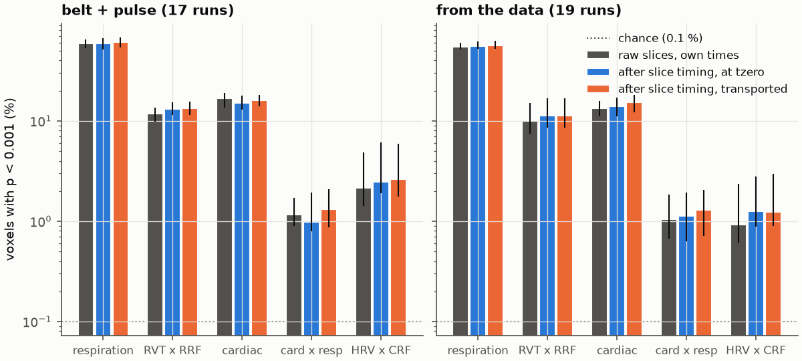
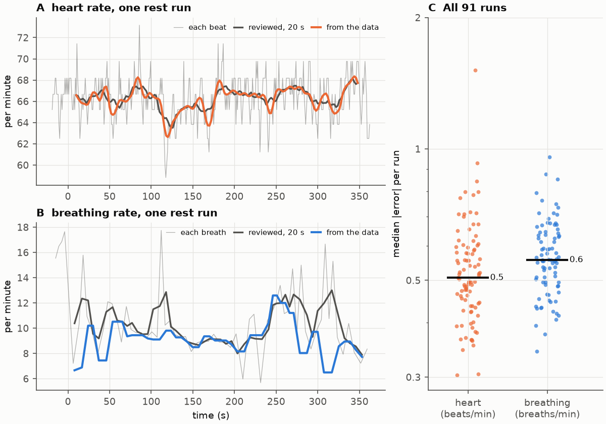
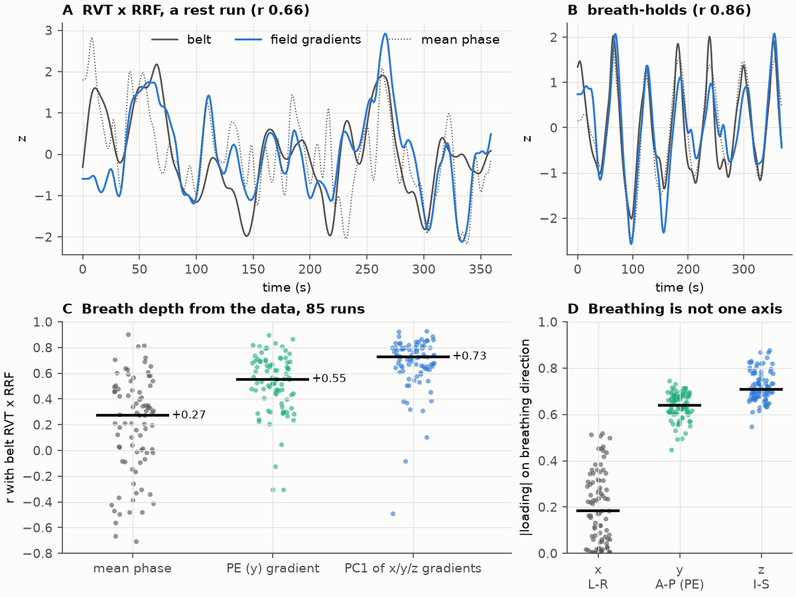
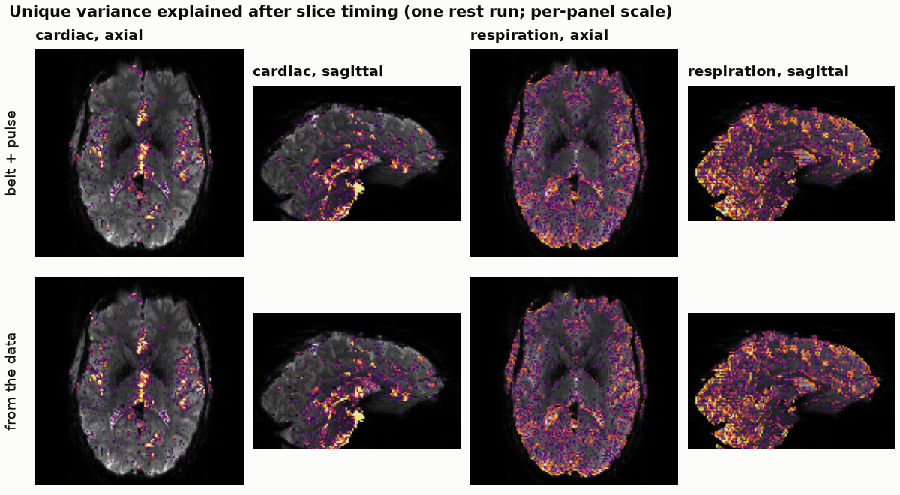
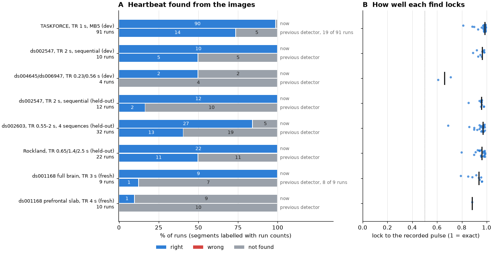

# `ffs_physio`: physiological noise from the data

> **Experimental.** Off by default (`ffs_autoproc -physio` opts in). Cardiac detection was
> checked against pulse recordings on 190 runs from seven datasets, TR 0.23–4 s. It found the
> heartbeat in 173 and never reported a wrong heart rate. At TR ≥ 2 s outside the prefrontal
> slab it found 42 of 46 runs; the previous detector found 9 of the 45 it scored
> (*Cardiac detection, against recordings*). Respiration and breath depth are validated on
> one dataset, and respiration from magnitude alone at long TR is unreliable (*Limits*).
> Wiki: *Constant-modulus cardiac start*, *Slice-time alignment of the heartbeat*.

Cardiac and respiratory noise regressors for 2-D (multiband) EPI, estimated from the
images themselves. No pulse oximeter or respiratory belt is needed. The output plugs
into the GLM the way recorded-physio regressors do (RETROICOR, RVT, and optionally
PhysIO's full set), and `ffs_autoproc -physio` runs it for every run.

## How it works

A 2-D EPI volume is not one sample of the heartbeat. Every excitation is. With 17
excitations per 1 s TR, reading them in acquisition order gives a trace at 17 Hz, fast
enough for the heartbeat that the 1 Hz volume rate aliases (figure 1C).

1. **Excitation-rate traces.** For each excitation, the mean over brain voxels of the
   fractional magnitude change (each voxel's mean and drift removed) and of the phase
   change (each voxel against its own 60 s running-mean phasor, so slow drift and sudden
   global phase steps do not drop voxels; no spatial unwrap). The magnitude
   trace carries cardiac pulsation, the phase trace carries respiration (breathing
   changes the magnetic field in the head).
2. **Rates and cycle phases.** Heart rate is tracked in sliding 20 s windows, never
   locking onto a harmonic of the TR. Breathing rate comes from breath-to-breath peaks.
   Cycle phases come from the analytic signal. All spectral steps run on the trace
   resampled to an even grid, since excitations are not evenly spaced in time.
3. **Cardiac: a start that needs no frequency.** At the volume rate the heartbeat is
   aliased, and heart-rate variability smears it, often onto 0 or the Nyquist rate where a
   spectral peak cannot be told from drift. But in every vessel voxel it is the same
   rotating phasor e^{iφ(t)} seen with that voxel's own gain and delay, so its cos/sin pair
   spans a 2-D temporal subspace of the whole-brain data **whose radius is constant**. The
   search finds that subspace directly: whitened top-20 temporal principal components of the
   magnitude (drift removed), and a 2-column rotation of them that makes the radius as flat
   as possible (fourth moment over squared second moment, on the orthonormal frames; every
   pair of components plus 64 random starts, all on the GPU at once). No band, rate or
   waveform enters, so a heartbeat aliased anywhere can be found. The best three rotations
   become candidate cardiac phases: each volume-to-volume step is lifted within π of the
   minute's mean step (and that within π of the run's), so the clock follows heart-rate drift
   without slipping a cycle.
3b. **Which alias, and is it the heartbeat? Judged by slice timing.** A volume-rate phase
   fixes the heart rate only up to multiples of 1/TR. A heartbeat is physical, so every
   vessel voxel samples it at its own slice's time: under the true cardiac phase, at each
   excitation's times, the best voxels' fitted delays **line up across excitations**, at the
   fundamental and at the second harmonic. Each candidate takes the alias (of all those in
   36–120/min) whose φ and 2φ line up best together. Almost everything that impersonates a
   heartbeat (drift, task residue, NORDIC's patch structure) is the same in every slice of a
   volume and does not line up. The best candidate is **found** only if:
   - its alignment beats every one of 30 derangements of the excitation times per candidate
     tried (Bonferroni; all drawn for the kept candidate), each re-choosing among the same
     aliases, and
   - its **second harmonic** lines up better than the same measure at 21 non-harmonic
     multiples of its phase (1.2–1.8, 2.2–2.8, 3.2–3.8 ×). Slow physical signals aliased
     into the band also follow slice timing; a pulse's waveform has a harmonic and they do
     not.

   The phase is used as found: re-tracking it from the best voxels (the previous refinement)
   dragged correct starts onto a wrong rate. When nothing is found, the previous path runs
   (cos/sin fits to a start from the mean trace or per-excitation ICA, the trace rebuilt from
   the best 1 % of voxels, eight passes, the same test); on the validation cohorts it never
   found a run the new start missed. With one excitation time (3-D EPI) the test is
   **untestable**. Not found is reported, and the cardiac columns are left out of the
   nuisance (`-card_unfound keep` keeps them). `PREFIX.cardiac_weight` maps where it was
   found. No tuned thresholds: the cardiac band (36–120/min) is the only fixed number.
4. **Breath depth (RVT) from the field's spatial gradients.** A smooth field is fitted
   to each excitation's phase-change map. Breathing moves along a direction in the
   left–right, front–back and up–down gradients (figure 3D), and the first principal
   component of those gradients gives breath depth. The mean phase gives breath *timing*
   but not depth.
5. **Regressors.** RETROICOR (cardiac and respiratory, 2nd order) and RVT at 0–4 s lags,
   evaluated at every slice's own acquisition time (`PREFIX.slibase.1D`, AFNI's
   slice-major layout, as `physio_calc.py` writes), and once at `-tzero` for a GLM on
   slice-timed data (`PREFIX.nuisance.1D`).


*Figure 1. One rest run. (A) The phase trace follows the respiratory belt, about 1.5 s
behind it. (B) The magnitude trace folded on the pulse oximeter's beats shows a clear
cardiac waveform; folded on another run's beats it nearly vanishes. (C) Only the excitation-rate
trace resolves the heartbeat and its second harmonic.*

## Using it

```sh
ffs_physio -input run_mag.nii.gz -phase run_phase.nii.gz -prefix physio/run01 \
    -tzero 0.47 -qc qc/
```

- Give it the **raw** magnitude (and phase, strongly recommended), before motion
  correction or slice timing. Slice timing and TR come from the BIDS sidecar.
- `-tzero T` writes `PREFIX.nuisance.1D`: the regressors at `f·TR + T`, the instant every
  voxel stands for after slice-timing correction to `T`. Use it as a per-run nuisance in
  the GLM on the preprocessed data.
- `-nuisance_set tapas` writes PhysIO's default set instead (cardiac 3rd, respiratory 4th,
  cardiac × respiratory 1st order, HRV × CRF, RVT × RRF).
- `-clean OUT` regresses each voxel's own-slice regressors out of the raw series
  (afni_proc's `ricor` order). See *Where in the pipeline* before using it.
- `-qc DIR` writes three figures and a metrics record: the tracked rates on each trace's
  spectrogram, maps of where cardiac, respiration and RVT explain variance, and maximum
  intensity projections of the cardiac weight map. A found heartbeat draws the arterial
  tree; speckle, slice stripes or a bright edge mean it was not found.

In `ffs_autoproc`, `-physio` runs it for every run and adds the nuisance to the GLM
(`-glm_ortvec physio`, in the default set). `-physio_mode clean` switches to the `ricor`
order.

Requirements: 2-D slice-by-slice acquisition, single echo for now. 3-D EPI has no
excitation-rate samples. Without phase, respiration is read from magnitude, which was
unreliable on task runs and at long TR (*Limits*).

## Where in the pipeline

**Default: a GLM nuisance on the preprocessed data, evaluated at `tzero`.** This is
PhysIO's placement (Kasper et al. 2017): the regressors share one GLM with the task, so
the GLM counts their degrees of freedom and task-correlated physiology is not handed to
the noise. Breathing is often task-locked.

**Cardiac survives slice timing.** Slice-timing interpolation shifts an aliased heartbeat
by the wrong phase, but by a constant phase per slice, which each voxel's cos/sin pair
absorbs. Jones et al. (2008) found one regressor set per volume within 0.2 % of
slice-specific ones on real data. Figure 5 shows the same here: after slice timing, the
cardiac regressors at `tzero` reach almost as many voxels as slice-specific ones on the
raw slices.



*Figure 5. Share of voxels where each regressor group explains variance beyond the others
(partial F, p < 0.001; bars are medians over runs, whiskers the middle half). Grey: each
slice's own-time regressors on raw slices. Blue: after slice timing, the regressors at
`tzero` (the default). Orange: after slice timing, each slice's regressors pushed through
the same interpolation, the exact but costlier version (Jones et al.'s motion-modified
RETROICOR). Interaction and HRV terms matter in 1–2.5 % of voxels.*

**`-physio_mode clean`** (afni_proc's `ricor` order) removes the fit from the raw slices
before slice timing, motion correction and the resample. In one study it lowered held-out
task R² where the nuisance did not, and its degrees of freedom go uncounted by the GLM. It
is kept for parity with AFNI pipelines.

## Validation

Pilot dataset: one participant, 91 runs over 10 sessions (rest, task, one breath-hold),
multiband 5, 85 slices, TR 1 s, 1.6 mm, magnitude and phase. Pulse oximeter and
respiratory belt recorded throughout, with reviewed beat and breath peaks. The recordings
are the reference; the data-derived regressors never see them.



*Figure 2. Heart and breathing rate from the data against reviewed peaks. Across 91 runs
the median heart-rate error is 0.5 beats/min (98 % of 20 s windows within 3) and the median
breathing-rate error 0.6 breaths/min (95 % within 2). The breathing rate is checked on
the 85 runs whose belt recorded.*



*Figure 3. (A, B) RVT × RRF from the field gradients against the belt's, in a rest run near
the median and through deliberate breath-holds. (C) Correlation with the belt's RVT over 85
runs: the mean phase gives timing but little depth (median r 0.27). The phase-encode (y)
gradient alone does better (0.55). The first principal component of all three gradients is
best (0.73; above 0.5 in 89 % of runs). (D) Breathing loads on the up–down and front–back
gradients and little on left–right: the field from the chest falls off toward the head
along every axis, not only the phase-encode one.*



*Figure 4. Unique variance explained after slice timing, regressors from the recordings
(top) and from the data (bottom). Cardiac sits on the brainstem and basilar artery, the
ventricles and the midline; respiration is broad and strongest at the
brain's edges. The two rows agree because the data-derived traces capture the same
physiology.*

Against the recordings' own regressors (AFNI `physio_calc.py` and TAPAS PhysIO on the same
logs), the data-derived set explains 85–100 % of the variance the recorded set does on raw
slices, with voxel maps correlated at 0.94–0.98.

### Cardiac detection, against recordings

Detection decides whether the cardiac regressors are used at all, so it is tested
separately on data it never saw during development. Each run is scored after the decision:
**right** = found, and the phase locks to the recorded pulse (phase-locking value > 0.5);
**wrong** = found, but not locked (a wrong rate or a drifting clock); **not found**. The
recordings play no part in any choice the detector makes.

- **Development:** TASKFORCE (above) and three OpenNeuro datasets used while building it.
- **Held-out:** 66 runs from ds002603 (four sequences, TR 0.55–2 s), Rockland (TR 0.645,
  1.4, 2.5 s) and ds002547 (TR 2 s, sequential), scored once the method was fixed.
- **Fresh:** ds001168 (TR 3 s full brain; TR 4 s, 0.8 mm prefrontal slab), opened only after
  the held-out results, with one fix made from it (the clock slip below), then all
  cohorts rerun on the final code.



*Figure 6. (A) Per dataset, the share of runs where the heartbeat was found and right, found
and wrong, or not found, for this detector (upper bar) and the previous one on the runs it
scored (lower bar). (B) Phase locking of each find to the recorded pulse; black ticks are
medians.*

| Data | TR | Runs | Right | Wrong | Not found | Before (right / runs) |
|---|---|---|---|---|---|---|
| TASKFORCE (development) | 1 s | 91 | 90 | 0 | 1 | 14 / 19 |
| ds002547, ds004645, ds006947 (development) | 0.23–2 s | 14 | 12 | 0 | 2 | 5 / 14 |
| ds002603, 4 sequences (held-out) | 0.55–2 s | 32 | 27 | 0 | 5 | 13 / 32 |
| Rockland 645 / 1400 / CAP (held-out) | 0.65–2.5 s | 22 | 22 | 0 | 0 | 11 / 22 |
| ds002547 (held-out) | 2 s | 12 | 12 | 0 | 0 | 2 / 12 |
| ds001168 full brain (fresh) | 3 s | 9 | 9 | 0 | 0 | 1 / 8 |
| ds001168 prefrontal slab (fresh) | 4 s | 10 | 1 | 0 | 9 | 0 / 10 |
| **All** | | **190** | **173** | **0** | **17** | |

Median locking of the finds is 0.94–0.99 per dataset (ds006947's two runs, TR 0.56 s, lock
at 0.61 and 0.71). Of the 17 not found, 9 are the prefrontal slab, where the recording
itself shows almost no pulsation (the one found locks at 0.88). In 5 of the other 8 the best
candidate did lock to the pulse (0.87–0.95) but fell short of the derangement floor: the
test errs toward not found. Two of those are ds004645 (TR 0.23 s): the candidate heartbeat
is unaliased and recovered, but the slice-alignment judge rejects even the recorded pulse
phase. This is a limitation of confirmation, not evidence that the heartbeat is absent
(see the [short-TR audit](../research_notes/physio_direct_phase/short_tr_audit/NOTES.md)). The previous detector
never found a run this one missed.

**Choices checked against the data, not tuned on it.** The number of principal components
(20) sits mid-plateau: on 105 runs, anywhere from 16 to 40 put the heartbeat among the
candidates in 100–103 runs. Pooling candidates from several counts rescued one run (the
breath-hold) at the cost of a stricter floor everywhere, so it is not used. The one fix
made after opening the fresh data was a clock slip: a ds001168 run locked at 0.97 for
7.5 min, then a noisy stretch shifted the unwrap reference by a whole cycle (reading 1/TR
fast to the end); anchoring that reference to the run's mean step fixed it (a regression
test reproduces the slip).

**Cost.** The search and the derangement null run batched on the GPU: one candidate set's
slice alignments (all aliases, both harmonics, every derangement) in one solve per
excitation, 0.18 s where one-at-a-time took 1.5 s; the constant-modulus search 0.4 s
(was 3.6 s); both halves' covariances for the split-half check from one pass over the data.

## Limits

- **3-D EPI**: not supported (no excitation-rate samples). Respiration might still be read
  from phase at the volume rate; not built.
- **Multi-echo**: refused for now; it should work (more samples per excitation) once tested.
- **Cardiac where pulsation is weak.** On a thin prefrontal slab (ds001168, 0.8 mm, TR 4 s)
  the heartbeat was found in 1 of 10 runs; the recording shows almost no pulsation there.
  Expect not found, not wrong, on slabs away from the large vessels. With few excitations per
  volume (TR 0.23 s), recovered unaliased heartbeats can fail spatial slice alignment;
  even the recorded clock failed in both runs checked. Confirmation for this regime
  remains open.
- **On data with no heartbeat at all**, "found" comes up about once in 100 runs (1 of 83
  synthetic noise-only runs): the chance rate of a test against 90 derangements. Every
  real run scored had a pulse, so this rate is not in the table above.
- **Respiration from magnitude alone at long TR is unreliable.** Without phase, the
  respiratory trace at TR 2 s sequential (ds002547) read the TR's own comb instead of
  breathing in all 10 runs checked. Their belt rates (16–23/min) exceed the volume-rate
  Nyquist limit (15/min), so recovery still depends on combining excitations correctly.
  Give the phase whenever it exists; a magnitude-only
  respiration path at long TR is open work.
- **A heart rate within ~3/min of k/TR** aliases to near zero in every voxel and cannot be
  told from drift; those rates are a blind zone, and so are k/TR ± the breathing rate.
- **Run it on the raw magnitude**, before NORDIC: on HiHiFaces fine, NORDIC strengthened the
  volume-locked component and one run found on raw data was not found after it.
- **The respiratory trace lags the belt by ~1.5 s.** The clocks agree to the tick, so this
  is the belt (abdominal) against the field (lung volume), not a sync error. RETROICOR
  absorbs a constant lag; RVT carries 0–4 s lags.
- **Data-derived RVT is not the belt's RVT** (median r 0.73 after RRF convolution). It
  tracks breath depth, but the measure is different. The belt is also an imperfect
  reference: set too tight, it clips at both ends of its range and stops measuring depth.
  Agreement falls as clipping rises (median r 0.74 over 59 runs with under 5 % of breaths
  clipped, 0.54 over 8 runs with over half clipped); the two negative runs clip on 59 % and
  71 % of breaths, and so do most rest runs here.
- **Raw-space QC maps** treat voxels as scanner locations, so a moving head also lights the
  brain's edge.

## References

- Glover, Li & Ress 2000, *Magn Reson Med* 44:162 — RETROICOR.
- Birn et al. 2006, *NeuroImage* 31:1536; Birn et al. 2008, *NeuroImage* 40:644 — RVT, RRF.
- Chang, Cunningham & Glover 2009, *NeuroImage* 44:857 — HRV, CRF.
- Harvey et al. 2008, *J Magn Reson Imaging* 28:1337 — higher-order and interaction terms.
- Jones, Bandettini & Birn 2008, *NeuroImage* 42:582 — order of corrections; slice-specific
  vs per-volume regressors; motion-modified RETROICOR.
- Kasper et al. 2017, *J Neurosci Methods* 276:56 — the PhysIO toolbox.
- Caballero-Gaudes & Reynolds 2017, *NeuroImage* 154:128 — review of BOLD cleaning methods.
- Beall & Lowe 2007, *NeuroImage* 37:1286 — PESTICA (physiology from the data by temporal ICA).
