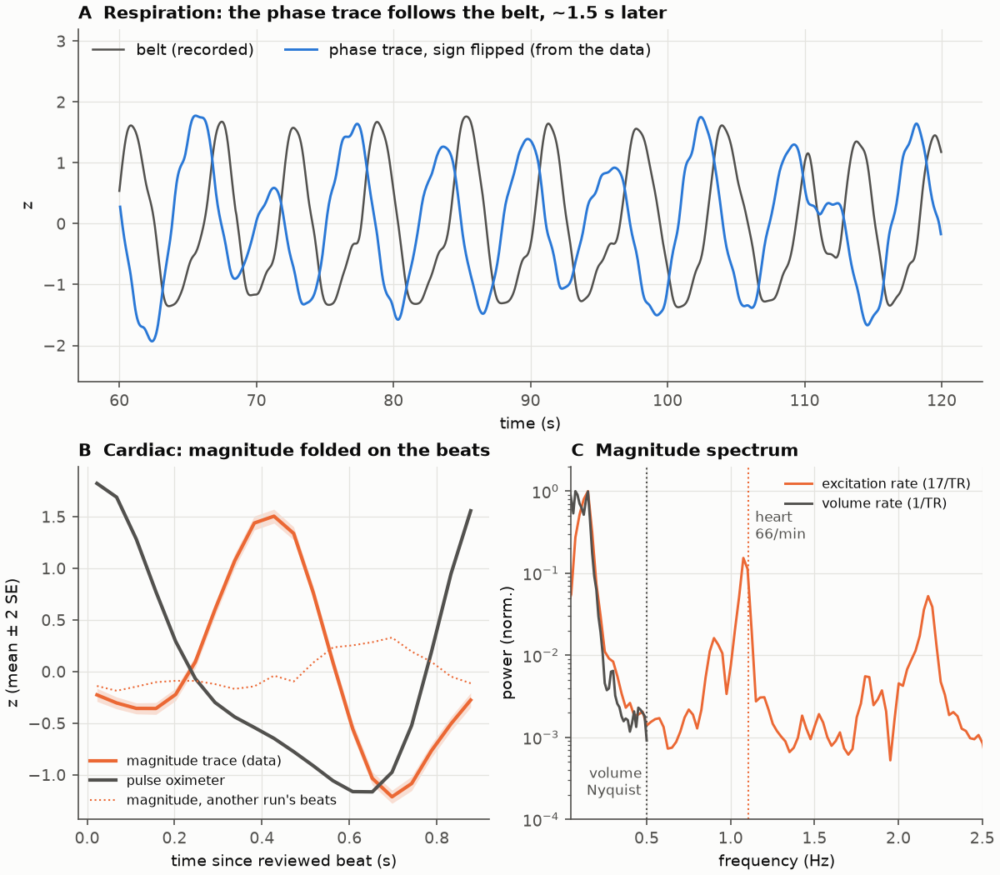

# `ffs_physio`: physiological noise from the data

Cardiac and respiratory noise regressors for 2-D (multiband) EPI, estimated from the
images themselves. No pulse oximeter or respiratory belt is needed. The output plugs
into the GLM the way recorded-physio regressors do (RETROICOR, RVT, and optionally
PhysIO's full set), and `ffs_autoproc -physio` runs it for every run.

## How it works

A 2-D EPI volume is not one sample of the heartbeat. Every excitation is. With 17
excitations per 1 s TR, reading them in acquisition order gives a trace at 17 Hz, fast
enough for the heartbeat that the 1 Hz volume rate aliases (figure 1C).

1. **Excitation-rate traces.** For each excitation, the mean over brain voxels of the
   fractional magnitude change (each voxel's mean and drift removed) and of the phase
   change (each voxel against its own temporal mean; no spatial unwrap). The magnitude
   trace carries cardiac pulsation, the phase trace carries respiration (breathing
   changes the magnetic field in the head).
2. **Rates and cycle phases.** Heart rate is tracked in sliding 20 s windows, never
   locking onto a harmonic of the TR. Breathing rate comes from breath-to-breath peaks.
   Cycle phases come from the analytic signal. All spectral steps run on the trace
   resampled to an even grid, since excitations are not evenly spaced in time.
3. **Breath depth (RVT) from the field's spatial gradients.** A smooth field is fitted
   to each excitation's phase-change map. Breathing moves along a direction in the
   left–right, front–back and up–down gradients (figure 3D), and the first principal
   component of those gradients gives breath depth. The mean phase gives breath *timing*
   but not depth.
4. **Regressors.** RETROICOR (cardiac and respiratory, 2nd order) and RVT at 0–4 s lags,
   evaluated at every slice's own acquisition time (`PREFIX.slibase.1D`, AFNI's
   slice-major layout, as `physio_calc.py` writes), and once at `-tzero` for a GLM on
   slice-timed data (`PREFIX.nuisance.1D`).



*Figure 1. One rest run. (A) The phase trace follows the respiratory belt, about 1.5 s
behind it. (B) The magnitude trace folded on the pulse oximeter's beats shows a clear
cardiac waveform; folded on another run's beats it nearly vanishes. (C) Only the excitation-rate
trace resolves the heartbeat and its second harmonic.*

## Using it

```sh
ffs_physio -input run_mag.nii.gz -phase run_phase.nii.gz -prefix physio/run01 \
    -tzero 0.47 -qc qc/
```

- Give it the **raw** magnitude (and phase, strongly recommended), before motion
  correction or slice timing. Slice timing and TR come from the BIDS sidecar.
- `-tzero T` writes `PREFIX.nuisance.1D`: the regressors at `f·TR + T`, the instant every
  voxel stands for after slice-timing correction to `T`. Use it as a per-run nuisance in
  the GLM on the preprocessed data.
- `-nuisance_set tapas` writes PhysIO's default set instead (cardiac 3rd, respiratory 4th,
  cardiac × respiratory 1st order, HRV × CRF, RVT × RRF).
- `-clean OUT` regresses each voxel's own-slice regressors out of the raw series
  (afni_proc's `ricor` order). See *Where in the pipeline* before using it.
- `-qc DIR` writes two figures and a metrics record: the tracked rates on each trace's
  spectrogram, and maps of where cardiac, respiration and RVT explain variance.

In `ffs_autoproc`, `-physio` runs it for every run and adds the nuisance to the GLM
(`-glm_ortvec physio`, in the default set). `-physio_mode clean` switches to the `ricor`
order.

Requirements: 2-D slice-by-slice acquisition, single echo for now. 3-D EPI has no
excitation-rate samples. Without phase, respiration is read from magnitude, which was
unreliable on task runs.

## Where in the pipeline

**Default: a GLM nuisance on the preprocessed data, evaluated at `tzero`.** This is
PhysIO's placement (Kasper et al. 2017): the regressors share one GLM with the task, so
the GLM counts their degrees of freedom and task-correlated physiology is not handed to
the noise. Breathing is often task-locked.

**Cardiac survives slice timing.** Slice-timing interpolation shifts an aliased heartbeat
by the wrong phase, but by a constant phase per slice, which each voxel's cos/sin pair
absorbs. Jones et al. (2008) found one regressor set per volume within 0.2 % of
slice-specific ones on real data. Figure 5 shows the same here: after slice timing, the
cardiac regressors at `tzero` reach almost as many voxels as slice-specific ones on the
raw slices.


*Figure 5. Share of voxels where each regressor group explains variance beyond the others
(partial F, p < 0.001; bars are medians over runs, whiskers the middle half). Grey: each
slice's own-time regressors on raw slices. Blue: after slice timing, the regressors at
`tzero` (the default). Orange: after slice timing, each slice's regressors pushed through
the same interpolation, the exact but costlier version (Jones et al.'s motion-modified
RETROICOR). Interaction and HRV terms matter in 1–2.5 % of voxels.*

**`-physio_mode clean`** (afni_proc's `ricor` order) removes the fit from the raw slices
before slice timing, motion correction and the resample. In one study it lowered held-out
task R² where the nuisance did not, and its degrees of freedom go uncounted by the GLM. It
is kept for parity with AFNI pipelines.

## Validation

Pilot dataset: one participant, 91 runs over 10 sessions (rest, task, one breath-hold),
multiband 5, 85 slices, TR 1 s, 1.6 mm, magnitude and phase. Pulse oximeter and
respiratory belt recorded throughout, with reviewed beat and breath peaks. The recordings
are the reference; the data-derived regressors never see them.


*Figure 2. Heart and breathing rate from the data against reviewed peaks. Across 91 runs
the median heart-rate error is 0.5 beats/min (98 % of 20 s windows within 3) and the median
breathing-rate error 0.6 breaths/min (95 % within 2). The breathing rate is checked on
the 85 runs whose belt recorded.*


*Figure 3. (A, B) RVT × RRF from the field gradients against the belt's, in a rest run near
the median and through deliberate breath-holds. (C) Correlation with the belt's RVT over 85
runs: the mean phase gives timing but little depth (median r 0.26). The phase-encode (y)
gradient alone does better (0.55). The first principal component of all three gradients is
best (0.72; above 0.5 in 88 % of runs). (D) Breathing loads on the up–down and front–back
gradients and little on left–right: the field from the chest falls off toward the head
along every axis, not only the phase-encode one.*


*Figure 4. Unique variance explained after slice timing, regressors from the recordings
(top) and from the data (bottom). Cardiac sits on the brainstem and basilar artery, the
ventricles and the midline; respiration is broad and strongest at the
brain's edges. The two rows agree because the data-derived traces capture the same
physiology.*

Against the recordings' own regressors (AFNI `physio_calc.py` and TAPAS PhysIO on the same
logs), the data-derived set explains 85–100 % of the variance the recorded set does on raw
slices, with voxel maps correlated at 0.94–0.98.

## Limits

- **3-D EPI**: not supported (no excitation-rate samples). Respiration might still be read
  from phase at the volume rate; not built.
- **Multi-echo**: refused for now; it should work (more samples per excitation) once tested.
- **Weak cardiac in magnitude**: no fallback yet (a PESTICA-style decomposition per
  excitation is the candidate).
- **The respiratory trace lags the belt by ~1.5 s.** The clocks agree to the tick, so this
  is the belt (abdominal) against the field (lung volume), not a sync error. RETROICOR
  absorbs a constant lag; RVT carries 0–4 s lags.
- **Data-derived RVT is not the belt's RVT** (median r 0.72 after RRF convolution). It
  tracks breath depth, but the measure is different. Agreement is weakest at rest, where
  depth varies least (median 0.56 over 9 rest runs, two of them negative).
- **Raw-space QC maps** treat voxels as scanner locations, so a moving head also lights the
  brain's edge.

## References

- Glover, Li & Ress 2000, *Magn Reson Med* 44:162 — RETROICOR.
- Birn et al. 2006, *NeuroImage* 31:1536; Birn et al. 2008, *NeuroImage* 40:644 — RVT, RRF.
- Chang, Cunningham & Glover 2009, *NeuroImage* 44:857 — HRV, CRF.
- Harvey et al. 2008, *J Magn Reson Imaging* 28:1337 — higher-order and interaction terms.
- Jones, Bandettini & Birn 2008, *NeuroImage* 42:582 — order of corrections; slice-specific
  vs per-volume regressors; motion-modified RETROICOR.
- Kasper et al. 2017, *J Neurosci Methods* 276:56 — the PhysIO toolbox.
- Caballero-Gaudes & Reynolds 2017, *NeuroImage* 154:128 — review of BOLD cleaning methods.
- Beall & Lowe 2007, *NeuroImage* 37:1286 — PESTICA (physiology from the data by temporal ICA).
