# pRF fitting: `ffs_pyrf` against analyzePRF

<!--
DRAFT. Placeholders:
  {{a.b.c}}  a value from docs/prf_validation/numbers.json (compare.py)
  {{v:a.b}}  a value from docs/prf_validation/numbers_variants.json (variants.py)
  TODO       prose to confirm once compare.py has run on the full analyzePRF set.
Numbers already written in come from numbers_variants.json (final), or from the
300-vertex probe where marked (probe), to be replaced.
-->

`ffs_pyrf` fits the compressive spatial summation (CSS) population receptive field
model of Kay et al. (2013) on the GPU. That is the model
[analyzePRF](https://github.com/cvnlab/analyzePRF) fits, and analyzePRF is the
reference here. This page tests three claims on public retinotopy data:

1. **It finds the same receptive fields as analyzePRF**, or better optima of the same
   objective, when given the same data, aperture and settings.
2. **It is much faster**: minutes on one GPU for what takes analyzePRF hours on a
   CPU pool.
3. **Its extra options help on held-out data.** analyzePRF has none of these: a
   per-vertex HRF library, data-driven denoising, and split-half cross-validation.

It also covers what any pRF fit can and cannot tell you about receptive-field size.
That is where toolboxes disagree most, for reasons that have nothing to do with code.

Every number on this page is in `docs/prf_validation/numbers*.json`.
`scripts/prf_validation/run.sh` regenerates all of it from the public dataset.

## At a glance

| claim | result |
|---|---|
| Same answers as analyzePRF (canonical HRF, same vertices) | position r = {{parity.x_r}} / {{parity.y_r}} (x / y); polar angle circular r = {{parity.angle_circ_r}}, median difference {{parity.angle_median_abs_deg}}°; eccentricity r = {{parity.ecc_r}} |
| Better or worse optimum (one independent float64 evaluator) | `ffs_pyrf` better by > 0.5 R² points on {{evaluator.frac_ffs_better_0p5}} of vertices, worse on {{evaluator.frac_ffs_worse_0p5}}; median difference {{evaluator.median_ffs_minus_apr}} points |
| Agrees with vistasoft as well as analyzePRF does | angle / eccentricity correlations with vistasoft: `ffs_pyrf` {{toolboxes.pairs.ffs_pyrf vs vistasoft.angle_circ_r}} / {{toolboxes.pairs.ffs_pyrf vs vistasoft.ecc_r}}, analyzePRF {{toolboxes.pairs.analyzePRF vs vistasoft.angle_circ_r}} / {{toolboxes.pairs.analyzePRF vs vistasoft.ecc_r}} |
| Speed, same {{n_screened}} vertices | analyzePRF {{speed.analyzeprf_s}} s on {{speed.analyzeprf_workers}} CPU workers; `ffs_pyrf` {{speed.ffs_parity_s}} s on one GPU |
| HRF library (the `ffs_pyrf` default) | held-out R² +6.5 points (median), better on 84% of responsive vertices; 75% of the noise ceiling, against 56% with the canonical HRF |
| Library + denoising | held-out R² +8.5 points, better on 92%; 79% of the noise ceiling |

## The model, briefly

Each vertex's receptive field is an isotropic 2-D Gaussian over the stimulus aperture,
with centre `x, y` and width `sigma`. The prediction is built in four steps:

1. Each TR, multiply the aperture by the Gaussian and sum. This is the *drive*.
2. Raise the drive to a power `n` (compressive when `n < 1`).
3. Convolve with an HRF.
4. Scale by a gain.

Polynomial drift (degree 2 per run here) is projected out of the data and the
prediction alike. The fit minimises the residual sum of squares over
`x, y, sigma, n`, solving for the gain exactly at each step.

`sigma` and `n` trade off along a nearly flat valley, so the size the model can
identify is `rfsize = sigma / sqrt(n)`. That is the size compared throughout.
Raw `sigma` and `n` appear only where the small-`n` regime needs explaining.

How `ffs_pyrf` fits it:

1. **Super-grid seeding.** analyzePRF's own candidate grid of positions × sizes ×
   exponents, with 32 polar angles instead of 16. Every vertex is scored against every
   candidate in one batched pass.
2. **Gauss-Newton refinement.** Uses Levenberg damping and variable projection for
   the gain, staged like analyzePRF's default: the exponent is held for the first half
   of the iterations, then freed.
3. **float64 polish.** Refinement runs in float32, then repeats in float64 starting
   from that answer. At small exponents the CSS model's value depends on float range
   (see [*Why float64 matters*](#why-float64-matters)). The polish is what makes the
   default agree with analyzePRF.

Options outside analyzePRF:

- a fast linear **screen** that skips vertices with no visual response;
- a per-vertex **HRF library**, the default (`-hrf library`): a 20-member family of
  double-gamma shapes, ordered early to late;
- **denoising** (`-denoise`): GLMdenoise-style noise components, with the number
  kept chosen by cross-validation;
- **split-half cross-validation** with parameter reliability (`-xval halves`).

## The test

- **Data.** [OpenNeuro ds003787](https://openneuro.org/datasets/ds003787) (NYU
  retinotopy; Himmelberg et al. 2021), subject `sub-wlsubj001`. The fmriprep series
  on the subject's own (fsnative) surface: six runs of 192 TRs each, TR 1 s,
  384,042 vertices across both hemispheres. About 1.4 GB to download.
- **Stimulus.** The dataset's aperture `.mat` files, 100 × 100 pixels. All six runs
  show the same sweep: bars in eight directions inside a circular aperture, with blank
  periods (figure 1). Both tools read the identical array.
- **Same input, both tools.** fmriprep's `.func.mgz` is converted to GIfTI once
  (`prepare.py`), and analyzePRF reads those same numbers back. The parity fit uses
  `-dont_scale`, so neither tool rescales the data.
- **Same model choices.**
  - Canonical HRF.
  - CSS with the staged exponent.
  - Polynomial degree 2 per run. That is analyzePRF's `round(run_seconds / 120)`,
    which equals `ffs_pyrf`'s default here.
  - analyzePRF's exponent lower bound of 0.001.
  - analyzePRF runs with its recommended `seedmode 2` (super-grid seeds) on 6 MATLAB
    workers.
- **Same vertices.** analyzePRF takes about a quarter of a second per vertex, so it
  fits only the vertices that `ffs_pyrf`'s screen keeps (figure 2). The parity fit is
  restricted to exactly that set with `-mask`.
- **One yardstick.** Each tool reports its own R². To ask which found the better
  optimum, both parameter sets are re-scored by an independent float64 numpy
  transcription of analyzePRF's model (`scripts/prf_validation/common.py`), which
  shares no code with `ffs_pyrf`. Given analyzePRF's own parameters and gains, it
  reproduces analyzePRF's reported R² to {{evaluator.reproduces_apr_r2_p99_abs}}
  (99th percentile).
- **Statistics.** Positions and eccentricity are compared with Pearson r. Polar angle
  is circular, so it is compared with the circular correlation
  (Jammalamadaka–SenGupta) and with wrapped differences (359° vs 1° is 2° apart).
  Sizes and exponents span decades, so they are compared on a log scale. Comparisons
  use vertices both tools fit with R² > 20%, unless noted.

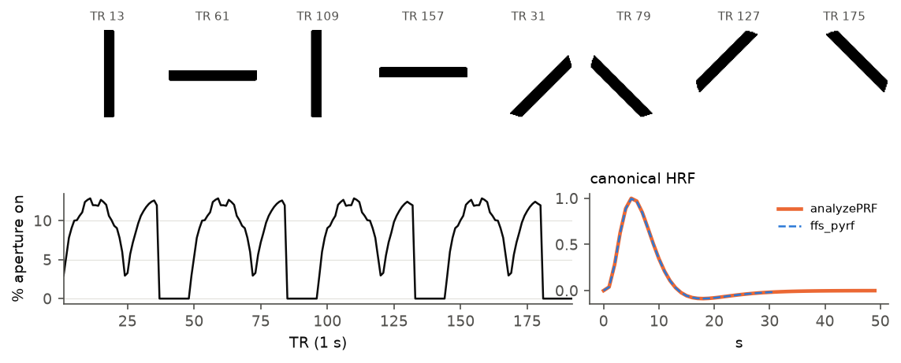

*Figure 1. Aperture frames from the sweep, the fraction of the aperture shown at each
TR, and the canonical HRF in both tools. The HRFs agree to within
{{hrf_max_abs_diff}} (peak = 1). analyzePRF keeps a 50 s tail where `ffs_pyrf` stops
at 32 s; that tail is at most {{hrf_truncated_tail_max}} of the peak.*

## Screening: where analyzePRF is pointed

`ffs_pyrf -screen` first fits a linear model (hashed Gaussian receptive fields, no
exponent) and keeps vertices whose cross-validated R² clears a threshold (0.1 here).
It takes seconds and decides where the expensive fit goes.

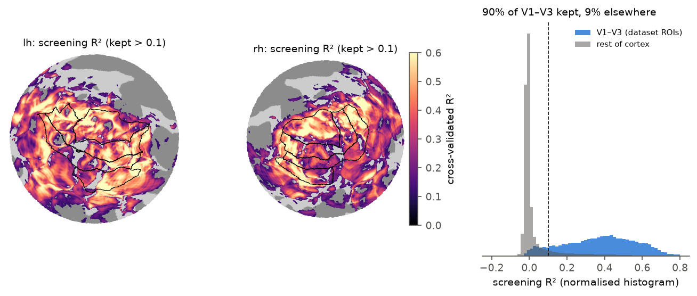

*Figure 2. Cross-validated R² of the linear screen on the occipital surface. The view
is a projection of the sphere centred on V1–V3; outlines are the dataset's V1, V2, V3
and hV4. The screen keeps {{screen.kept}} vertices ({{screen.kept_frac}} of cortex):
{{screen.v1v3_kept_frac}} of V1–V3 and {{screen.outside_kept_frac}} of everything
else.*

What the screen drops was checked against vistasoft, the dataset's own fits. About
18,600 vertices that vistasoft fits with variance explained > 20% fail the screen.
They lie mostly outside V1–V3, at eccentricities up to 31°, far beyond the 12.4°
stimulus. Inside V1–V3, vistasoft passes 16,673 of 18,086 vertices at > 20% and
`ffs_pyrf` 14,217. vistasoft's variance explained runs higher across the board
(median 0.77 against `ffs_pyrf`'s R² of 0.45 on the same vertices). That fits it being
computed on the average of all twelve runs, where noise is much lower, though this is
an inference: the dataset does not document it.

## Parity with analyzePRF

<!-- TODO: confirm direction and size from the full run; the probe (300 vertices) gave
the numbers in brackets. -->

On the same vertices, `ffs_pyrf` and analyzePRF place receptive fields in the same
spots:

- median position difference {{parity.position_median_px}} pixels of a 100-pixel
  aperture (probe: 0.48);
- polar angle median difference {{parity.angle_median_abs_deg}}° (probe: 1.75°);
- eccentricity r = {{parity.ecc_r}} (probe: 0.98).

Agreement tightens as R² rises (`parity.by_threshold`). rfsize agrees in the median
(ratio {{parity.rfsize_median_ratio}}; probe 0.99) but scatters vertex by vertex
(r(log) = {{parity.rfsize_r_log}}; probe 0.70). The exponent agrees least
(r(log) = {{parity.exponent_r_log}}; probe 0.48). That is expected, not a defect:
[*Size and exponent*](#size-and-exponent-what-the-data-can-and-cannot-pin-down) shows
both tools are on the same flat ridge of the objective.

On the common yardstick, `ffs_pyrf` finds the better optimum more often than
analyzePRF does: better by more than half an R² point on
{{evaluator.frac_ffs_better_0p5}} of vertices (probe: 17%), worse on
{{evaluator.frac_ffs_worse_0p5}} (probe: 1%), within half a point on the rest.

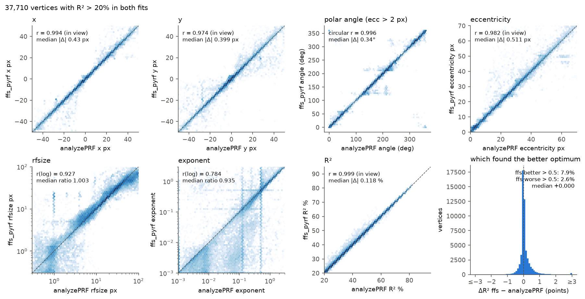

*Figure 3. `ffs_pyrf` (y) against analyzePRF (x) on the vertices both fit with R² >
20%. Panels: x, y, polar angle (circular), eccentricity, rfsize and exponent (log),
R². The last panel is the per-vertex R² difference on the independent evaluator;
right of zero means `ffs_pyrf` found the better fit.*

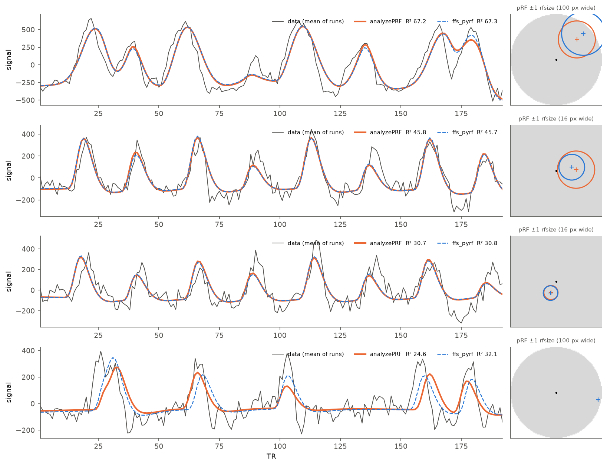

*Figure 4. Data and both tools' predictions at vertices spanning the R² range,
including the largest disagreements. The insets show both receptive fields on the
aperture. TODO: describe the vertices once picked from the full run.*

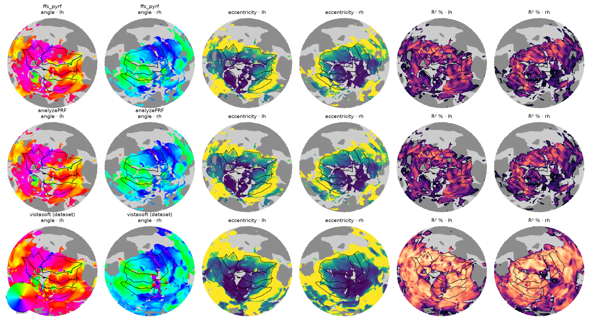

*Figure 5. Polar angle, eccentricity and R² on the occipital surface for `ffs_pyrf`,
analyzePRF and vistasoft. vistasoft's y axis points down, so its angle is mirrored to
match. Its eccentricity is in degrees; the CSS tools' pixels are converted at
{{toolboxes.deg_per_px}}°/pixel. That conversion is estimated from the data (median
ratio of eccentricities), and the published 12.4° stimulus radius gives 0.248.*

## Three toolboxes: agreement and consistency

pRF toolboxes differ in model, HRF, drift handling and optimiser, so two of them never
agree vertex for vertex. The useful test is whether `ffs_pyrf` sits where a trusted
CSS toolbox sits relative to a third, independent one. The third here is vistasoft's
linear Gaussian model (Dumoulin & Wandell 2008), fitted by the dataset's authors to
all twelve runs.

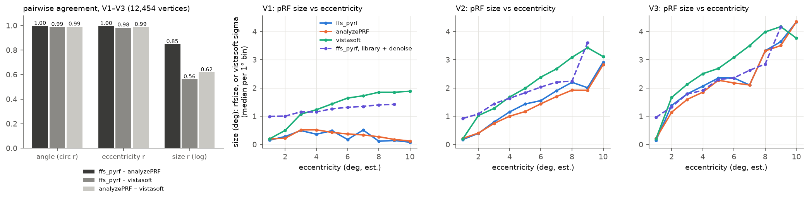

*Figure 6. Left: pairwise agreement on angle (circular r), eccentricity (r) and size
(r on log scale) for the three pairs. Right: size against eccentricity in V1, V2 and
V3, with one line per toolbox.*

- **Position.** `ffs_pyrf` agrees with vistasoft as closely as analyzePRF does: angle
  circular r {{toolboxes.pairs.ffs_pyrf vs vistasoft.angle_circ_r}} against
  {{toolboxes.pairs.analyzePRF vs vistasoft.angle_circ_r}} (probe 0.88 / 0.91);
  eccentricity r {{toolboxes.pairs.ffs_pyrf vs vistasoft.ecc_r}} against
  {{toolboxes.pairs.analyzePRF vs vistasoft.ecc_r}} (probe 0.95 / 0.96). On the full
  V1–V3 set (14,033 vertices with R² > 20% in both), `ffs_pyrf` and vistasoft agree on
  angle with circular r 0.951 and a median difference of 2.8°.
- **Size.** Both CSS tools report sizes about half of vistasoft's sigma (median ratio
  {{toolboxes.pairs.ffs_pyrf vs vistasoft.size_median_ratio}} for `ffs_pyrf`,
  {{toolboxes.pairs.analyzePRF vs vistasoft.size_median_ratio}} for analyzePRF; probe
  0.53 / 0.55). The two are different quantities. A linear model has to absorb
  compressive spatial summation into a larger Gaussian, which is the effect Kay et al.
  (2013) introduced the exponent to capture. The CSS tools agree with each other on
  this ratio, which is the check that matters.
- **Size against eccentricity.** All three show size growing with eccentricity, and
  faster in V2 than V1. TODO: per-area slopes from `toolboxes.size_ecc` (the probe had
  too few V3 vertices).

## Size and exponent: what the data can and cannot pin down

Getting receptive-field size right is hard in any toolbox. On these data, four facts
shape how to read it.

**1. The exponent is barely constrained.** For the vertices where the two tools
disagree most, `ffs_pyrf` refit each one at fixed exponents across the whole range,
re-optimising position and size at each step (figure 7, right). R² stays within 0.1
points over a 1,400–2,000-fold range of `n` (probe). Both tools' answers sit on that
plateau, so "which exponent is right" has no answer in these data. Of the probe
vertices where the tools' rfsize differs by more than 1.5×, R² differs by a median of
only 0.27 points.

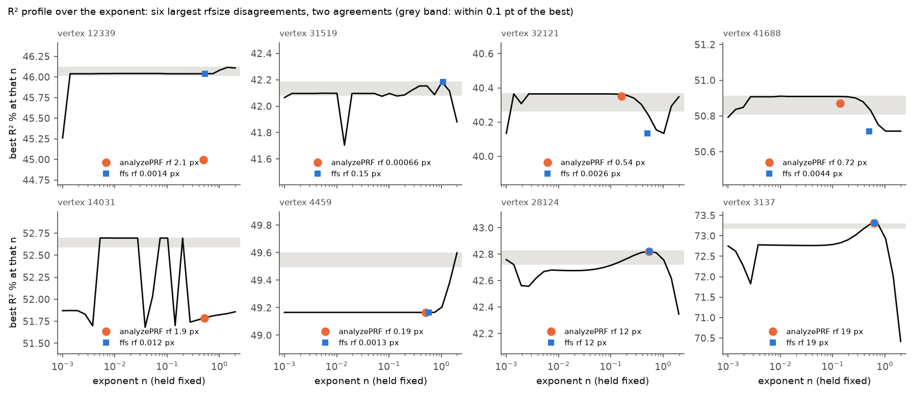

*Figure 7. Left: rfsize agreement between the tools, split by whether `ffs_pyrf`'s own
rfsize reproduces across halves of the data (within 25%). Right: R² at fixed exponent
(each point re-optimises position and size) for the vertices that disagree most. The
two tools' answers are marked. The curves are flat across decades of `n`.*

**2. Most well-fit vertices sit at very small exponents.** The fits are not frozen
seeds: `n` below 0.01 is genuinely common.

**3. The HRF, not the optimiser, drives rfsize.** With the canonical HRF, a third of
V1–V3 vertices have sub-pixel receptive fields. The canonical HRF is too slow and
broad for these TR = 1 s data (see
[*What the extra options change*](#what-the-extra-options-change)), and a smaller
receptive field sharpens the predicted response to compensate. With the HRF library,
sub-pixel sizes nearly vanish, the median V1–V3 size doubles, and twice as many
vertices reproduce their size across halves. Exponents get *smaller* with the library,
so the small-`n` regime is real data behaviour, not a side effect of the HRF.

Vertices well fit (R² > 20%) by all four variants:

| | V1–V3: rfsize < 1 px | median rfsize | split-half rfsize within 25% | `n` < 0.01 | all vertices: split-half within 25% |
|---|---|---|---|---|---|
| canonical HRF | 36% | 3.0 px | 27% | 57% | 40% |
| HRF library | 6% | 5.6 px | 57% | 76% | 56% |
| canonical + denoise | 32% | 3.9 px | 28% | 56% | 38% |
| library + denoise | 3% | 5.9 px | 58% | 75% | 55% |

*14,134 V1–V3 vertices, 37,593 in all (`size_exponent` in numbers_variants.json).*

**4. The parity comparison runs where rfsize is least determined.** To match
analyzePRF, it must use the canonical HRF, so matching analyzePRF's rfsize means
matching a poorly constrained number. Position is the robust part of a pRF fit, and
that is where the tools agree tightly.

The practical upshot: read rfsize at the population level (medians, size against
eccentricity), not vertex by vertex. Use the HRF library (the default), and use
`-xval halves`, which writes a per-vertex reliability map that says where a size is
trustworthy.

## Why float64 matters

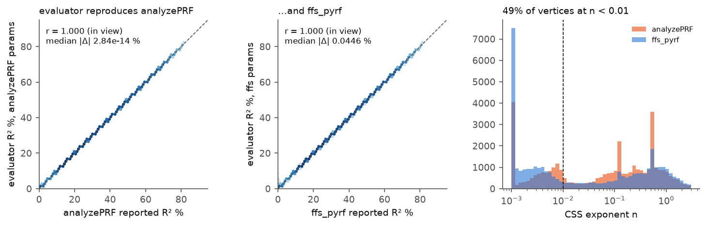

*Figure 8. Left: each tool's reported R² against the independent evaluator's. For
analyzePRF the two are identical by construction, which validates the evaluator.
Right: distribution of fitted exponents in both tools.*

The first comparison (300 vertices) found `ffs_pyrf` behind analyzePRF. A quarter of
vertices kept their super-grid exponent exactly (0.125, 0.25 or 0.5), and 15% were
more than half an R² point worse on the same data. There were two causes.

**A Jacobian bug.** The chain rule floored the drive at float eps (1.2e-7 in float32)
before raising it to `n − 1`. At small `n`, drives far below that floor still shape
the prediction: a drive of 1e-10 contributes 0.056 at `n = 0.125`. The derivative was
therefore wrong wherever a receptive field only grazes the bar. Steps were rejected
until the damping hit its cap, and the vertex froze. The fix rewrites the chain rule
so it never forms `drive^(n−1)`, and a regression test covers it.

**The model depends on float range at small n.** As `n → 0`, `drive^n ≈ 1` for any
drive that has not underflowed to zero. How far the Gaussian's tail still counts is
then set by the arithmetic: about 13 sigma in float32, about 38 sigma in float64. At
small `n`, float32 and float64 are fitting different functions. analyzePRF is
float64, and most well-fit vertices sit in that regime (above), so `ffs_pyrf`
polishes in float64. Where `n` ≥ 0.2, every precision gives the same R² to two
decimals.

How each fix moved the 300 probe vertices (median R² difference against analyzePRF on
the common evaluator; share more than 0.5 points worse):

| configuration | median Δ R² | worse by > 0.5 |
|---|---|---|
| original (float32, eps-floored Jacobian) | −0.041 | 15% |
| fixed Jacobian, float32 throughout | −0.126 | 30% |
| fixed Jacobian, float64 throughout | +0.129 | 2% |
| **fixed Jacobian, float32 then float64 polish (default)** | **+0.149** | **2%** |

The fixed Jacobian looks worse in float32 alone. Correct derivatives let the
optimiser move further into the small-`n` regime, where float32 is fitting the
wrong function. The two fixes only pay off together. Damping changes and computing
only the SSE in float64 recovered almost nothing (−0.038 and −0.040).

**An exact alternative, tested and not adopted.** The float range dependence can be
removed entirely by computing the drive in log space (a log-sum-exp over stimulated
pixels), which needs no float64. On 60 small-`n` vertices fit separately on two halves
of the runs, this exact model and the float64 model had the same held-out R² (median
difference 0.000). Their split-half rfsize was no more reproducible either: 15% within
1.2× for the exact model against 17% for float64. The float64 underflow edge costs no
predictive accuracy. The exact model remains an option for a float64-free path on
Apple GPUs.

`-refine_precision float32` skips the polish. Refinement is then about 5× faster
(whole-cortex fit 138 s against 305 s), with different results at small `n`. Apple's
Metal has no float64, so on MPS the polish is skipped with a note. Use `-device cpu`
there for analyzePRF-equivalent fits.

## Speed

<!-- TODO: rerun timings on an idle machine; these were taken with the CPU shared. -->

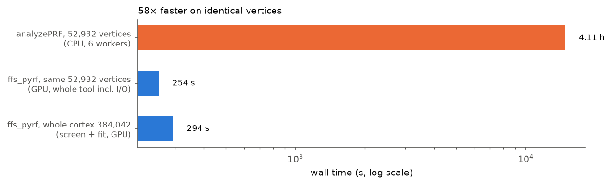

*Figure 9. Wall time on the same {{n_screened}} vertices: analyzePRF on
{{speed.analyzeprf_workers}} MATLAB workers against `ffs_pyrf` on one GPU (TODO:
model). Also shown: `ffs_pyrf` on the whole cortex, which loads all 384,042 vertices,
screens them and fits the {{screen.kept}} that pass.*

- analyzePRF: {{speed.analyzeprf_s}} s for {{n_screened}} vertices (probe: 0.26
  s/vertex on 6 workers).
- `ffs_pyrf`, same vertices, canonical HRF, no cross-validation:
  {{speed.ffs_parity_s}} s.
- `ffs_pyrf`, whole cortex from raw surfaces including the screen:
  {{speed.ffs_cortex_s}} s.
- The options cost time but stay in minutes. With `-xval halves` on the screened set:
  canonical HRF 741 s, HRF library 1,256 s, canonical + denoise 973 s, library +
  denoise 1,355 s. Each fits the data three times (full data and both halves).

## What the extra options change

The parity fit pins `ffs_pyrf` to analyzePRF's choices. This section asks what its own
options add, judged on held-out data: each half of the runs is predicted by a fit to
the other half. Four variants were fit to the same screened vertices with
`-xval halves`:

- **canonical HRF**: analyzePRF's model;
- **HRF library**: each vertex picks its HRF from the library (the `ffs_pyrf` default);
- **canonical + denoise**;
- **library + denoise**.

Unless stated, statistics use the 45,398 *responsive* vertices, those with held-out
R² > 5% under the canonical HRF.

### Held-out R²

| variant | median held-out R² | Δ vs canonical (all / V1–V3) | vertices improved | fraction of noise ceiling |
|---|---|---|---|---|
| canonical HRF | 24.8% | — | — | 0.56 |
| HRF library | 35.4% | +6.5 / +6.3 | 84% | 0.75 |
| canonical + denoise | 26.8% | +0.8 / +1.5 | 64% | 0.59 |
| library + denoise | 37.9% | +8.5 / +9.1 | 92% | 0.79 |

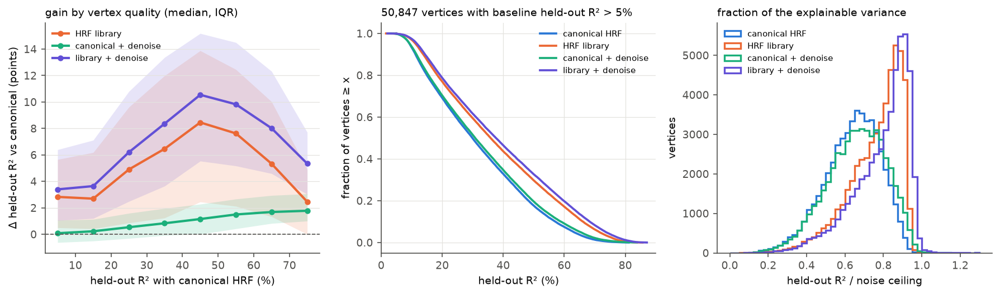

*Figure 10. Left: held-out gain over the canonical HRF, binned by the canonical fit's
own held-out R² (median and interquartile range). Middle: fraction of responsive
vertices above each held-out R². Right: held-out R² as a fraction of the noise ceiling.
The ceiling is the split-half reliability of the data themselves, which works here
because all runs show the same stimulus.*

- **The HRF library is the big win.** It helps nearly everywhere, most for
  moderately responsive vertices (+9 points at 30–40% held-out R²). Even the
  best-fit vertices gain. Where the canonical HRF reaches 56% of the explainable
  variance (median), the library reaches 75%.
- **Denoising adds a little by itself and more on top of the library.** The
  cross-validated choice kept 2 noise components from a pool of 234,240 vertices with
  no stimulus response (screen R² < 0; 0.1% of the pool lies inside V1–hV4). Its gain
  grows with vertex quality, the opposite of the library's.
- **The two combine.** Library + denoise improves 92% of responsive vertices.

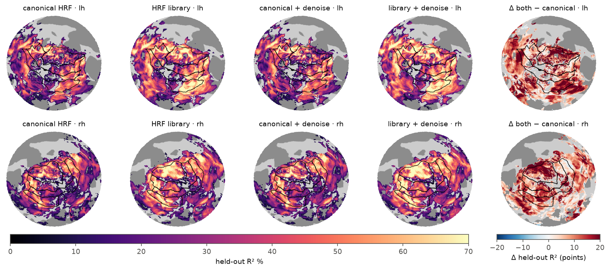

*Figure 11. Held-out R² on the occipital surface for each variant, and the gain of
library + denoise over the canonical HRF (right; ±20 points). The gain covers V1–V3
and extends well beyond them.*

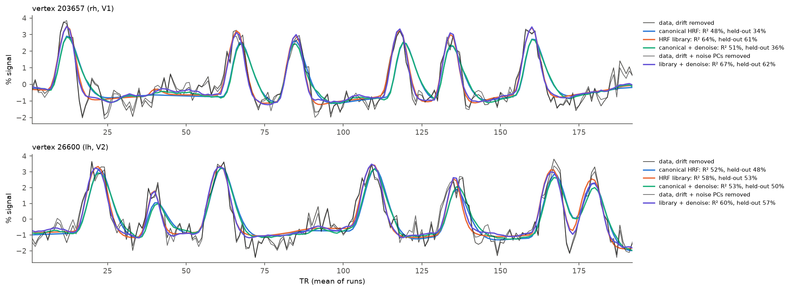

*Figure 12. Why the library wins. A V1 vertex (top) and a V3 vertex (bottom), averaged
over runs. The canonical predictions (blue, green) peak late and decay slowly. The
library's HRF follows the data's sharper, earlier responses. V1 vertex: held-out R²
38% canonical, 63% library, 66% library + denoise. The canonical HRF is analyzePRF's
default too, so this applies to analyzePRF fits of these data.*

### Reliability

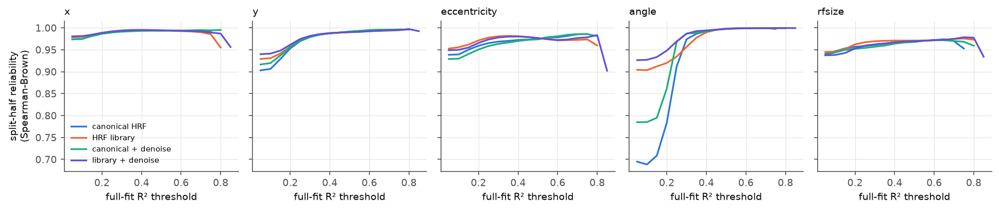

*Figure 13. Split-half reliability of each parameter across vertices (Spearman–Brown
corrected correlation between the two halves' fits), against the full-fit R² a vertex
must reach to be counted.*

At an R² threshold of 0.2:

| variant | x | y | eccentricity | angle | rfsize |
|---|---|---|---|---|---|
| canonical HRF | 0.988 | 0.954 | 0.963 | 0.781 | 0.959 |
| HRF library | 0.989 | 0.957 | 0.971 | 0.920 | 0.962 |
| canonical + denoise | 0.988 | 0.957 | 0.955 | 0.861 | 0.955 |
| library + denoise | 0.989 | 0.962 | 0.966 | 0.948 | 0.953 |

Position is highly reliable in every variant. Polar angle is the parameter that
benefits: at modest R², the library and denoising each raise its reliability, and
together they take it from 0.78 to 0.95. Above R² ≈ 0.35 all variants converge near 1.

rfsize reliability *across* vertices is high everywhere (0.95–0.96), because sizes
span decades with eccentricity and area. It hides the per-vertex picture in
[the size table above](#size-and-exponent-what-the-data-can-and-cannot-pin-down): only
27% of V1–V3 vertices reproduce their size within 25% under the canonical HRF, against
58% with library + denoise.

### Parameter changes

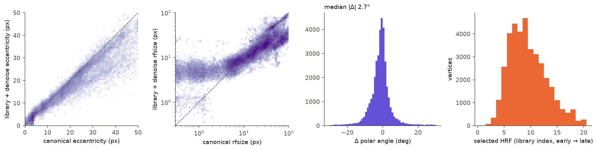

*Figure 14. Library + denoise against the canonical HRF, on vertices well fit by both:
eccentricity, rfsize (log), change in polar angle, and the selected HRF (library index,
early to late).*

On vertices whose receptive fields lie inside the aperture under both fits:

| vs canonical HRF | position shift, median (90th pct) | eccentricity change (median) | angle change (median) | rfsize ratio (median) |
|---|---|---|---|---|
| HRF library | 1.9 px (8.5) | −1.1 px | 2.3° | 1.08 |
| canonical + denoise | 0.6 px (2.6) | +0.2 px | 0.9° | 1.05 |
| library + denoise | 2.1 px (8.8) | −1.1 px | 2.6° | 1.17 |

- **Denoising barely moves the receptive fields.** It sharpens them: less than a pixel
  of position and a degree of angle.
- **The library moves them slightly inward.** Eccentricity drops by about a pixel
  (median), with r = 0.94 against the canonical fit. The selected HRF is mostly
  earlier than mid-library: median index 9 (IQR 7–12) of 20.
- **The rfsize panel is the sub-pixel story.** The cluster of canonical sizes below
  ~3 px maps to 4–6 px with the library.

**Receptive fields outside the aperture.** Some fits place the centre beyond the
stimulus edge (eccentricity > 50 px with R² > 20%):

| | V1 | V2 | V3 | hV4 | beyond V1–hV4 | all |
|---|---|---|---|---|---|---|
| canonical HRF | 1% | 2% | 2% | 37% | 50% | 31% |
| HRF library | 1% | 1% | 0% | 6% | 27% | 15% |
| library + denoise | 1% | 1% | 0% | 6% | 27% | 15% |

In V1–V3 these are mostly real. vistasoft, fit to the same subject, places the same
vertices at 12.6–16.6°, beyond the 12.4° stimulus. In hV4 and beyond, the canonical
HRF pushes over a third of fits off the screen, and the library brings most of them
back. About 18% of vertices cross the aperture edge between the canonical and library
fits, against 4% for denoising.

## Which mode to use

| goal | settings |
|---|---|
| Best receptive-field estimates | defaults (`-hrf library`), add `-denoise` with 2+ runs, `-xval halves` for reliability maps |
| Reproduce analyzePRF | `-hrf canonical -dont_scale`, polynomial degree matched; leave `-refine_precision` at its default |
| Fastest screening of a large dataset | `-refine_precision float32` (positions agree; small-exponent sizes and exponents do not) |
| Apple GPU (MPS) | runs float32 throughout; `-device cpu` for float64 parity at small exponents |

## Reproducing

```sh
scripts/prf_validation/run.sh            # downloads, fits, figures
```

Needs the AWS CLI (anonymous S3 access), MATLAB with the Parallel Computing Toolbox,
and analyzePRF. analyzePRF dominates the runtime (hours). Each `ffs_pyrf` fit takes
minutes on a GPU. Steps whose output already exists are skipped.

## Limits

- One subject and one stimulus protocol (bars only). Wedge/ring designs, other TRs
  and volume (non-surface) data are not covered here.
- The parity comparison covers the vertices `ffs_pyrf`'s screen keeps. Vertices it
  drops are compared only against vistasoft.
- Timings were taken with the CPU shared with other work. analyzePRF would be
  somewhat faster on an idle machine.
- The noise ceiling relies on all runs showing an identical stimulus.
- On Metal (MPS), small-exponent fits are float32 and do not match analyzePRF there
  (see above).

## References

- Kay KN, Winawer J, Mezer A, Wandell BA (2013). Compressive spatial summation in
  human visual cortex. *J Neurophysiol* 110(2):481–494.
  https://doi.org/10.1152/jn.00105.2013 (analyzePRF; cite when using `ffs_pyrf`.)
- Himmelberg MM, Kurzawski JW, Benson NC, Pelli DG, Carrasco M, Winawer J (2021).
  Cross-dataset reproducibility of human retinotopic maps. *NeuroImage* 244:118609.
  https://doi.org/10.1016/j.neuroimage.2021.118609 (the dataset.)
- Dumoulin SO, Wandell BA (2008). Population receptive field estimates in human visual
  cortex. *NeuroImage* 39:647–660. https://doi.org/10.1016/j.neuroimage.2007.09.034
  (vistasoft's linear pRF, the dataset's own fits.)
